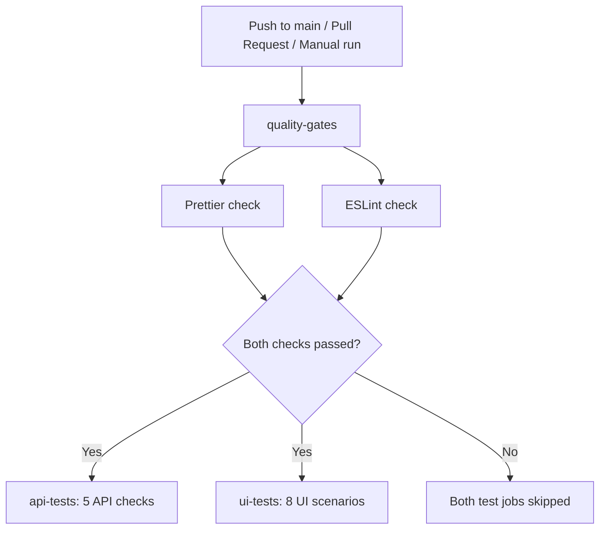

# Module 10 — Quality Gates and Automation Tools

A standalone WebdriverIO/Mocha/Chai UI suite and Node.js API suite with a GitHub Actions quality gate. Prettier and ESLint must both pass before either test job starts.

## Implemented

- Prettier with explicit formatting rules and exclusions for generated files.
- ESLint flat configuration, recommended JavaScript rules, Node.js globals and Mocha globals scoped to UI specs.
- `eslint-config-prettier` to disable rules that conflict with Prettier.
- Separate npm commands for each linter, a combined check and an explicit formatting command.
- A `quality-gates` CI job that blocks both `ui-tests` and `api-tests` through `needs`.
- Real UI/API suites, a lockfile and demonstration instructions; no other repository is needed.

## Technologies and prerequisites

Use Node.js 24 LTS (see `.nvmrc`), npm, Chrome/Chromium and Internet access. The project uses WebdriverIO 9, Mocha, Chai, Node's built-in API test runner, Prettier 3 and ESLint 9.

```sh
npm ci
npm run lint
```

Installation and browser provisioning require access to npm and Chrome for Testing download hosts. Tests use the public demo services at `practicesoftwaretesting.com`, `api.practicesoftwaretesting.com` and `restful-booker.herokuapp.com`. No private credentials are required.

## Commands

| Command                 | Purpose                                          | Changes files?             |
| ----------------------- | ------------------------------------------------ | -------------------------- |
| `npm run lint:prettier` | Check formatting of supported project files      | No                         |
| `npm run lint:eslint`   | Check JavaScript; warnings also fail the command | No                         |
| `npm run lint`          | Run Prettier, then ESLint                        | No                         |
| `npm run format`        | Apply Prettier formatting locally                | Yes                        |
| `npm run test:api`      | Run five booking lifecycle checks                | Demo API data only         |
| `npm run test:ui`       | Run eight UI scenarios                           | Demo application data only |
| `npm test`              | Run the API suite, then the UI suite             | Demo application data only |

CI uses the check commands, never the formatting command. A formatting or lint error produces a nonzero exit code. Local `npm run lint` stops at the first failing command; the CI job runs both linters after dependency installation succeeds so both sets of errors are visible.

## Configuration

`.prettierrc.json` sets two-space indentation, semicolons, single quotes, trailing commas, a 100-character print width and LF line endings. `.gitattributes` keeps text line endings consistent between platforms. `.prettierignore` excludes dependencies, generated artifacts, coverage and the npm-generated lockfile. JavaScript, JSON, YAML and Markdown are checked. `docs/scenarios.feature` preserves the original Gherkin requirements as documentation, without adding a Gherkin formatter or Cucumber runtime.

`eslint.config.js` uses the recommended rule set and explicitly rejects unused variables, `var`, unnecessary `let`, and loose equality. Mocha globals are available only in `tests/specs/**/*.spec.js`; the API tests import Node's test runner. `eslint-config-prettier` is applied last. `--max-warnings=0` prevents warning-only results from passing the gate. No source or test directories are excluded from linting.

## CI execution order



The workflow is `.github/workflows/ci.yml`. The gate is declared first and both test jobs have `needs: quality-gates`; YAML position alone does not enforce ordering. There is no `continue-on-error` or unconditional execution on dependent test jobs. UI and API jobs may run in parallel only after the gate succeeds.

Each job checks out the code and installs the same locked dependencies with `npm ci`. GitHub-hosted Ubuntu 24.04 provides Chrome. Failed UI runs upload screenshots. The gate writes a summary with the individual Prettier and ESLint outcomes. The workflow runs on pull requests, pushes to `main`, and manual dispatch; concurrent obsolete runs on the same ref are cancelled.

This gate enforces test-job ordering. Preventing a maintainer from merging a failed PR is a separate GitHub branch protection/ruleset setting, not configured by this project.

In GitHub Actions run [38808006878](https://github.com/rusikmihajlan/module10/actions/runs/38808006878), Prettier, ESLint and all five API tests passed; the GitHub-hosted UI job received a Cloudflare human-verification page and uploaded screenshots. Local runs through this cloud browser pass all eight UI scenarios. The workflow does not bypass or suppress the challenge. Run [38808722946](https://github.com/rusikmihajlan/module10/actions/runs/38808722946) is the deliberate failing demo: both linter steps failed and both dependent test jobs were skipped.

## Test suites

The UI suite preserves all eight original scenarios: sign in, profile update, product details, basket, favorites, search, sorting and category filtering. Page Objects and shared browser mechanics are separated from tests. Each UI scenario gets a fresh session; authenticated scenarios register unique customers. Public demo accounts remain until the service resets its data. Search, sort and category checks traverse pagination.

The API suite preserves the existing sequential booking lifecycle: authenticate, create, retrieve, update and delete. Run the complete API suite as one workflow; its five steps share the booking created within that run. These API checks are independent of the UI suite.

```sh
# Run one UI scenario; --spec paths are relative to tests/config/wdio.conf.js
npm run test:ui -- --spec ../specs/02-profile.spec.js

# Use a locally installed Chromium (POSIX shell)
CHROME_BIN=/usr/bin/chromium npm run test:ui

# Optional visible browser
HEADLESS=false npm run test:ui
```

UI options: `BASE_URL` overrides the application origin; `CHROME_BIN` and `CHROMEDRIVER_BIN` select local executables; `BROWSER_PROXY` sets an optional proxy; `TEST_ORDER=reverse` reverses UI file order. Defaults are headless Chrome and the public application. With no browser path override, WebdriverIO discovers/downloads the browser and matching driver.

In PowerShell, set environment variables separately, for example `$env:HEADLESS = 'false'; npm run test:ui`.

In the Codex cloud environment:

```sh
NODE_USE_ENV_PROXY=1 npm run test:api
CHROME_BIN=/usr/bin/chromium BROWSER_PROXY="$HTTPS_PROXY" npm run test:ui
```

Keep the environment's trusted proxy CA configured in Node and the browser trust store; TLS verification stays enabled. Chromium needs access to its NSS trust store in this environment. No local proxy address, credentials or downloaded browser binaries are committed.

## Structure

```text
module10/
├── .github/workflows/ci.yml       # Quality gate and dependent test jobs
├── .gitattributes                # Portable line endings
├── .gitignore
├── .nvmrc
├── .prettierignore
├── .prettierrc.json
├── eslint.config.js
├── package.json
├── package-lock.json
├── README.md
├── docs/
│   ├── DEMO.md                   # Mentor demonstration walkthrough
│   └── scenarios.feature        # Original UI requirements
├── src/
│   ├── core/BasePage.js          # Application-independent browser operations
│   └── business/
│       ├── components/Header.js
│       ├── flows/CustomerFlow.js
│       └── pages/
│           ├── AccountPage.js
│           ├── CatalogPage.js
│           ├── FavoritesPage.js
│           ├── LoginPage.js
│           ├── ProductPage.js
│           ├── ProfilePage.js
│           └── RegistrationPage.js
└── tests/
    ├── api/booking.test.js
    ├── config/wdio.conf.js
    ├── fixtures/customer.js
    └── specs/
        ├── 01-login.spec.js
        ├── 02-profile.spec.js
        ├── 03-product.spec.js
        ├── 04-basket.spec.js
        ├── 05-favorites.spec.js
        ├── 06-search.spec.js
        ├── 07-sort.spec.js
        └── 08-category.spec.js
```

## Mentor demonstration

See [docs/DEMO.md](docs/DEMO.md) for the walkthrough and how to compare a blocked run with the corrected run. Open the PR's Checks tab or the repository's Actions tab to inspect actual job results.

## Jenkins pipelines (Module 11)

See [`jenkins/README.md`](jenkins/README.md) for the local Jenkins LTS setup, the separate UI and API jobs, and their two-hour schedule.
